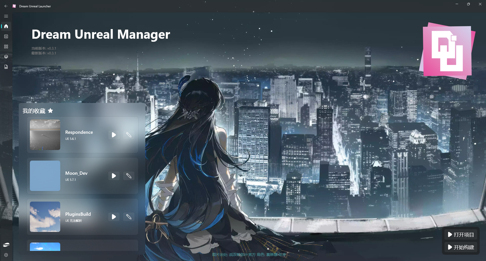
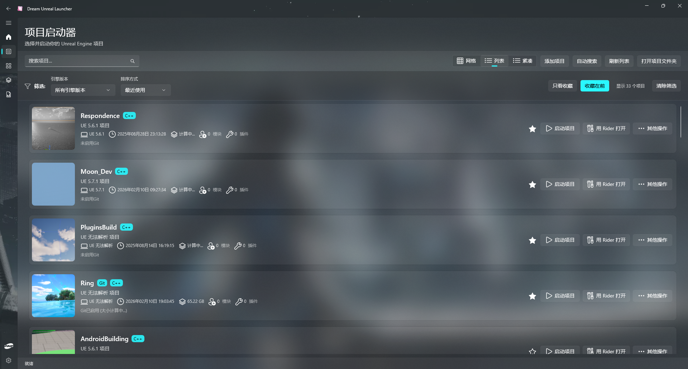
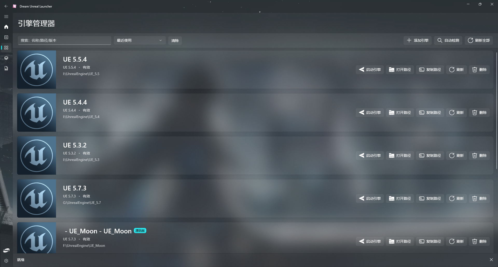
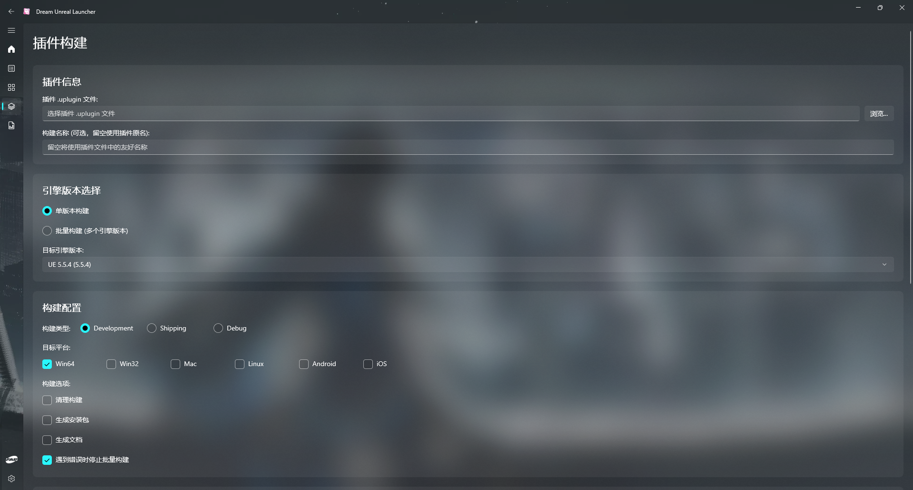
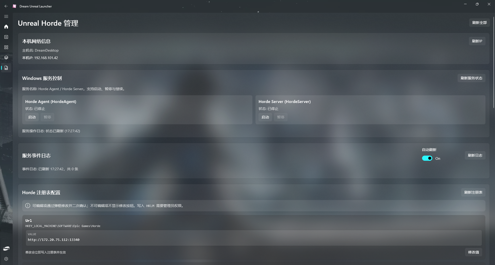
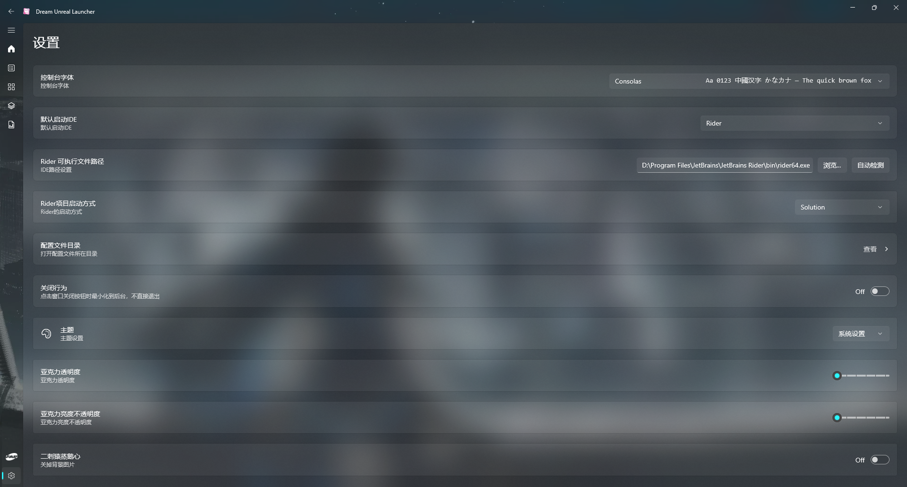

# Dream Unreal Manager

<p align="center">
  
</p>

<p align="center">
  一个基于 <b>WinUI 3</b> 的 Unreal Engine 工具箱，聚焦项目启动、引擎管理、插件构建与 Horde 运维。
</p>

<p align="center">
  
  
  
  
</p>

<p align="center">
  <a href="https://github.com/TypeDreamMoon/DreamUnrealManager/actions/workflows/ci.yml"></a>
  <a href="https://github.com/TypeDreamMoon/DreamUnrealManager/actions/workflows/release.yml"></a>
  <a href="https://github.com/TypeDreamMoon/DreamUnrealManager/releases/latest"></a>
</p>

---

## 目录

- [项目简介](#项目简介)
- [功能概览](#功能概览)
- [Gallery](#gallery)
- [快速开始](#快速开始)
- [发布流程](#发布流程)
- [配置与数据文件](#配置与数据文件)
- [项目结构](#项目结构)

## 项目简介

Dream Unreal Manager 是一个桌面端 Unreal Engine 管理器，当前聚焦以下场景：

- 管理本地 `.uproject` 并快速启动
- 管理多个 Unreal Engine 安装目录
- 可视化执行插件构建（含批量构建）
- 管理 Unreal Horde 服务、日志与注册表配置
- 统一 IDE、主题、透明度等开发体验设置

## 功能概览

| 模块 | 说明 |
| --- | --- |
| Main | 首页入口、版本检查、收藏项目快捷启动 |
| Launcher | 项目列表管理、搜索筛选、收藏、引擎切换、生成 VS 工程文件 |
| Unreal Launcher | 引擎列表管理、自动检测、设置默认引擎、快速启动编辑器 |
| Plugins Build | 选择 `.uplugin`、单/多引擎构建、平台配置、实时日志与问题统计 |
| Fab Compliance | 依据 Fab《Technical Review Checklist》自动 + 人工检查插件上架合规性，支持一键清理生成目录与导出报告 |
| Unreal Horde | 服务状态控制、事件日志查看、注册表配置管理 |
| Settings | 默认 IDE、IDE 路径自动检测、主题、Acrylic 参数、关闭行为等 |
| Fab | 内置 WebView2 页面入口 |

## Gallery

| 主页 | 项目启动器 |
| --- | --- |
|  |  |

| 引擎管理 | 插件构建 |
| --- | --- |
|  |  |

| Horde 管理 | 设置页面 |
| --- | --- |
|  |  |

## 快速开始

### 环境要求

- Windows 10/11（建议 Windows 11）
- .NET SDK 8.0+
- Visual Studio 2022（含 WinUI / Windows App SDK 开发组件）

### 构建与运行

```powershell
dotnet restore .\DreamUnrealManager.sln
dotnet build .\DreamUnrealManager.sln -c Debug
dotnet run --project .\DreamUnrealManager\DreamUnrealManager.csproj -c Debug -f net8.0-windows10.0.22000.0
```

## 发布流程

构建与发布已全部交给 GitHub Actions，本地不再需要手工打包。

| 工作流 | 触发时机 | 作用 |
| --- | --- | --- |
| [`ci.yml`](.github/workflows/ci.yml) | push 到 `main`、PR、手动 | Release / x64 构建校验 |
| [`release.yml`](.github/workflows/release.yml) | 推送 `v*` 标签、手动 | 发布产物并创建 GitHub Release |

### 发布一个新版本

```powershell
pwsh ./tools/release.ps1 -Version 0.3.2 -Push
```

脚本会更新 `DreamUnrealManager.csproj` 的 `<Version>` 与 README 徽章，提交并打出 `v0.3.2`
标签后推送；也可以省略 `-Push` 先在本地确认，再手动推送。手工发布同样可行：

```powershell
git tag -a v0.3.2 -m "Dream Unreal Manager v0.3.2"
git push origin v0.3.2
```

### 标签推送后发生了什么

1. 从标签解析版本号（`v0.3.2` → `0.3.2`），并以 `-p:Version` 注入构建，
   保证程序内的版本检查与 Release 标签一致。
2. `dotnet publish -c Release -r win-x64`，self-contained + ReadyToRun。
3. 产出两份分发物并各自生成 `.sha256` 校验和：
   - `DreamUnrealManager-v0.3.2-win-x64.zip` —— 免安装版，解压即用
   - `DreamUnrealManager-v0.3.2-win-x64-Setup.exe` —— 安装包，由
     [`installer/DreamUnrealManager.iss`](installer/DreamUnrealManager.iss) 编译，
     默认按当前用户安装（无需 UAC），带开始菜单快捷方式与卸载程序，
     向导中可切换为所有用户安装
4. 用自动生成的更新日志创建 Release 并上传产物；带后缀的标签
   （如 `v0.4.0-beta.1`）自动标记为预发布。

> 需要额外架构时，在 `release.yml` 的 `matrix.include` 中取消 `win-arm64` / `win-x86`
> 的注释即可，其余流程无需改动。

## 配置与数据文件

程序默认写入以下目录：

```text
%LOCALAPPDATA%\DreamUnrealManager\
```

常见文件：

- `engines.json`：引擎列表与引擎信息
- `projects.json`：项目列表
- `projects_backup.json`：项目列表备份

## 项目结构

```text
DreamUnrealManager/
├─ .github/workflows/           # CI 构建与 Release 发布流水线
├─ installer/                   # Inno Setup 安装包脚本
├─ DreamUnrealManager/          # WinUI 主项目（Views / Services / ViewModels）
├─ DreamUnrealManager.Core/     # 核心公共库
├─ tools/release.ps1            # 版本号更新 + 打 tag 助手
├─ DreamUnrealManager.sln       # 解决方案
└─ README.md                    # 当前说明文档
```
